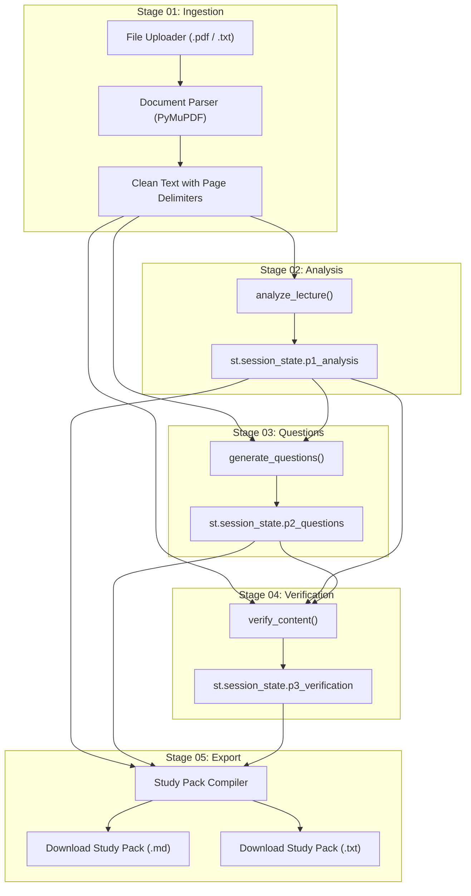
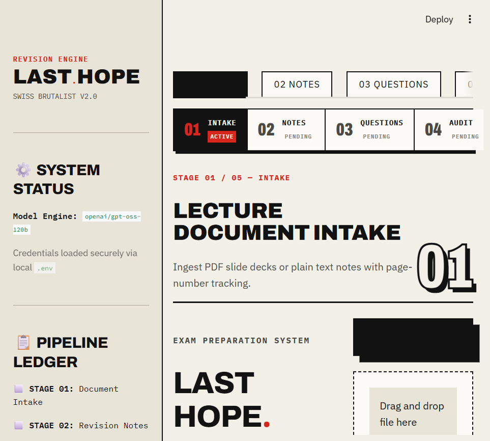
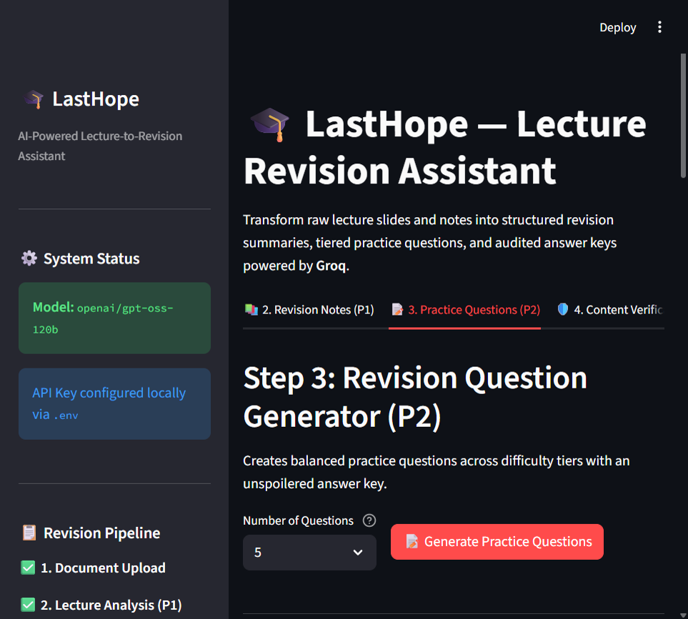

# LastHope — Lecture-to-Revision Assistant
## Milestone 2 Main Report: Prompt Engineering, Implementation & Evaluation

**Team Name:** Temperature 0  
**Project Repository:** [https://github.com/hriday-thakur/LastHope](https://github.com/hriday-thakur/LastHope)  

---

# SECTION 1: COVER PAGE

### Academic Submission Details

| Field | Submission Information |
| :--- | :--- |
| **Project Title** | LastHope — AI Lecture-to-Revision Assistant |
| **Team Name** | Temperature 0 |
| **Team ID** | PE-B65-36 |
| **Batch / Section / Group** | Batch 80 / Section 40 / Group 20 |
| **Course Code & Title** | SCSE4041 — Prompt Engineering |
| **Faculty Guide / Mentor** | Dr. Sonal Kukreja |
| **Institution** | Bennett University |
| **Team Member 1** | Hriday Thakur (Enrollment ID: S24CSEU2000) |
| **Team Member 2** | Keshav Kumar (Enrollment ID: S24CSEU1998) |
| **Team Member 3** | Rudransh Jiyala (Enrollment ID: S24CSEU2013) |
| **Milestone** | Milestone 2 Submission |
| **Submission Date** | 22 November 2026 |
| **Video Reel Demonstration** | `[Video Demonstration / Reel URL: e.g., https://drive.google.com/...]` |
| **Live Hosted Prototype** | `[Live Hosted Prototype URL: e.g., https://share.streamlit.io/... (Optional / If Hosted)]` |

---

# SECTION 2: PROMPT AND SOLUTION DESIGN

### 2.1 Problem Statement and Proposed Solution
Academic lecture slides and course handouts are typically optimized for live classroom presentations rather than independent exam revision. Consequently, they are terse, heavily fragmented, and frequently omit explicit derivations, parameter definitions, and self-assessment questions. When students attempt to use general-purpose Large Language Models (LLMs) to synthesize revision aids, they encounter severe pedagogical hazards:
1. **Curriculum Extrapolation & Hallucination:** Unconstrained LLMs frequently introduce advanced textbook mechanisms (such as unmentioned cache replacement policies or complex associativity levels) that were never taught in the specific lecture, misleading students on examinable scope.
2. **Arithmetic & Cycle-Count Errors:** General-purpose LLMs struggle with multi-step arithmetic, frequently introducing numerical inaccuracies in performance equations (e.g., Average Memory Access Time calculations).
3. **Internal Answer-Key Contradictions:** Models often declare one letter in an answer key header (e.g., `Option B`), but proceed to calculate or argue that another option (e.g., `Option A`) is correct in the explanation body.
4. **Silent Student Failure:** Lacking an independent audit trail, students have no mechanism to distinguish between factually grounded notes and plausible hallucinations.

**The Proposed Solution (LastHope):**  
LastHope solves these challenges through a modular, multi-stage prompt chaining architecture:
- Extracted text from PDF and TXT lecture documents is tagged with explicit page boundaries (`--- [Page X] ---`).
- **Prompt 1 (P1)** analyzes the lecture to produce structured revision notes while citing specific source pages.
- **Prompt 2 (P2)** generates tiered revision practice questions (MCQs, Short-Answer, and Quantitative problems) with an unspoilered practice mode and separate answer key.
- **Prompt 3 (P3)** acts as an adversarial auditor that cross-examines generated notes and questions against the original lecture slides, recalculating formulas from first principles, flagging label discrepancies, and assigning an audit status (`PASS`, `PASS WITH WARNINGS`, or `NEEDS REVISION`).
- An editorial export engine bundles the verified content into downloadable Markdown and Plaintext Study Packs.

---

### 2.2 Workflow & Task Decomposition
The end-to-end task flow is decomposed into five discrete, state-managed stages:

```
┌────────────────────────────────────────────────────────────────────────┐
│ Stage 01: Document Intake & Preprocessing                              │
│ • Ingests PDF or TXT files via PyMuPDF and multi-encoding handler      │
│ • Preserves page markers: "--- [Page X] ---"                           │
│ • Validates non-empty content and outputs Intake Receipt               │
└───────────────────────────────────┬────────────────────────────────────┘
                                    │
                                    ▼
┌────────────────────────────────────────────────────────────────────────┐
│ Stage 02: Lecture Content Analysis (Prompt 1)                          │
│ • Analyzes lecture text using strict grounding directives              │
│ • Outputs 5-part Markdown notes with granular page attributions        │
│ • Identifies syllabus gaps without external domain extrapolation       │
└───────────────────────────────────┬────────────────────────────────────┘
                                    │
                                    ▼
┌────────────────────────────────────────────────────────────────────────┐
│ Stage 03: Practice Questions & Assessment Generation (Prompt 2)        │
│ • Ingests lecture text + P1 structured notes                           │
│ • Synthesizes tiered practice questions (Easy/Medium/Hard)             │
│ • Separates Part 1 (Practice Mode) from Part 2 (Answer Key)            │
└───────────────────────────────────┬────────────────────────────────────┘
                                    │
                                    ▼
┌────────────────────────────────────────────────────────────────────────┐
│ Stage 04: Content Verification & Fact-Check Audit (Prompt 3)           │
│ • Cross-examines P1 & P2 against original lecture text                 │
│ • Independently recomputes arithmetic; checks answer-key label sync    │
│ • Emits audit report with status badge (PASS / WARNINGS / REVISION)    │
└───────────────────────────────────┬────────────────────────────────────┘
                                    │
                                    ▼
┌────────────────────────────────────────────────────────────────────────┐
│ Stage 05: Consolidated Study Pack Export                               │
│ • Assembles complete, verified study pack docket                       │
│ • One-click downloads for Markdown (.md) and Plaintext (.txt)          │
└────────────────────────────────────────────────────────────────────────┘
```

---

### 2.3 Input / Output Flow & Screen Architecture



---

### 2.4 Three Final Implemented Prompts (P1, P2, P3)

The following specifications document the exact prompts currently implemented and active in the production codebase.

#### 2.4.1 Prompt 1 (P1): Lecture Content Analyzer
- **Implementation File:** [`prompts/lecture_analyzer.py`](../../../prompts/lecture_analyzer.py)
- **Role:** Extracts structured, student-friendly revision outlines, terminology tables, and high-yield takeaways from raw lecture text.
- **Actual System Prompt:**
```markdown
You are an expert academic lecture analyst and revision assistant.
Your job is to analyze extracted lecture notes and slide decks to produce structured, accurate, and student-friendly revision notes.

### Core Directives:
1. Strict Factual Grounding: Rely strictly and solely on the provided lecture text. Do not invent facts, introduce unsupported external assumptions, or hallucinate concepts not present in the input.
2. Technical Accuracy: Preserve all original technical terms, formula names, algorithm names, and notations verbatim.
3. Clarity for Students: Explain terse or difficult concepts in clear, accessible academic language without changing or oversimplifying their technical meaning.
4. Page Attribution: The lecture text contains page markers in the format `--- [Page X] ---`. You must cite these page numbers (e.g., `[Page 1]`, `[Pages 2-3]`) whenever referencing specific definitions, topics, or formulas.
5. Explicit Gaps & Ambiguities: If a note or slide is incomplete, lacks context, contains an undefined variable, or is ambiguous, explicitly flag it under "Topics Needing Clarification" rather than guessing.
6. Structured Markdown Output: Format your output in clean, professional GitHub-flavored Markdown following the exact required sections below.

### Output Structure:
# 📚 Lecture Revision Notes: [Topic Title]

## 1. Executive Overview
- High-level summary of the lecture scope and primary objectives.
- Estimated source coverage (e.g., Pages 1 to N).

## 2. Topic-by-Topic Breakdown
For each distinct topic or subtopic covered in the lecture:
### [Topic Name] *(Source: [Page X])*
- **Core Concept**: Student-friendly explanation grounded strictly in the text.
- **Key Details & Mechanisms**: Bullet points explaining how it functions, properties, or trade-offs.
- **Formulas / Algorithms / Rules** (if present): Stated with exact notation from the text.

## 3. Key Terminology & Definitions
| Term / Concept | Definition & Explanation (Grounded in Lecture) | Source Page |
| :--- | :--- | :--- |
| ... | ... | [Page X] |

## 4. High-Yield Revision Takeaways
- Top 3 to 5 critical takeaways essential for exam revision or conceptual mastery.

## 5. Topics Needing Clarification & Potential Gaps
- Any points in the lecture text that were incomplete, tersely stated without full context, or suggested questions the student should clarify with their professor.
```
- **Actual User Prompt Template:**
```markdown
Please analyze the following extracted lecture material and generate the complete structured revision notes according to your instructions.

--- BEGIN LECTURE MATERIAL ---
{lecture_text}
--- END LECTURE MATERIAL ---
```
- **Variable Definition Table:**
| Variable Name | Type | Population Source | Description |
| :--- | :--- | :--- | :--- |
| `{lecture_text}` | `str` | `st.session_state.parsed_doc.extracted_text` | Cleaned text extracted from the uploaded PDF/TXT file containing `--- [Page X] ---` delimiters. |

---

#### 2.4.2 Prompt 2 (P2): Revision Question Generator
- **Implementation File:** [`prompts/question_generator.py`](../../../prompts/question_generator.py)
- **Role:** Synthesizes exam-oriented practice questions across cognitive tiers with an unspoilered practice layout and comprehensive answer key.
- **Actual System Prompt:**
```markdown
You are an expert academic assessment specialist and exam question designer.
Your mission is to generate high-yield, exam-oriented revision practice questions based solely on the provided lecture text and structured lecture analysis.

### Core Directives:
1. Strict Grounding in Material: Every question, answer option, and explanation must be directly derivable from the provided lecture text and analysis. Never introduce external concepts, unmentioned facts, or outside curriculum.
2. Cognitive Depth & Variety: Create a balanced set testing multiple cognitive levels:
   - Recall & Terminology: Foundational definitions, component roles, and basic facts.
   - Conceptual Understanding: Comparing mechanisms, explaining trade-offs, and "why/how" questions.
   - Application & Problem-Solving: Quantitative calculations using lecture formulas or applying principles to specific technical scenarios.
3. Difficulty Calibration: Explicitly tag every question with a difficulty tier:
   - [Easy]: Direct recall or single-fact identification.
   - [Medium]: Conceptual distinction, trade-off explanation, or multi-step logic.
   - [Hard]: Formula application, performance calculation, or multi-concept synthesis.
4. Balanced Question Distribution:
   - Section A: Multiple-Choice Questions (MCQs) - 4 clear options (A, B, C, D) with exactly one correct answer and plausible, non-arbitrary distractors.
   - Section B: Short-Answer Questions - precise, high-impact exam questions requiring 2-3 sentence model answers.
   - Section C: Conceptual & Application Questions - deeper questions involving calculations, scenario evaluations, or mechanism walkthroughs.
5. Page Citations: Cite the relevant source page (e.g., `[Page X]`) for every question and answer.
6. Self-Testing Friendly Layout: Group all questions together first (so students can test their recall without spoilers), followed by a clear dividing line and a comprehensive, step-by-step Answer Key & Explanations section.

### Markdown Output Template:
# 📝 Revision Practice Questions: [Topic]

## Part 1: Questions (Practice Mode)

### Section A: Multiple-Choice Questions
1. **[Easy/Medium/Hard]** [Question text] *(Source: [Page X])*
   - A) [Option A]
   - B) [Option B]
   - C) [Option C]
   - D) [Option D]

### Section B: Short-Answer Questions
[Numbered questions with difficulty tags and page references]

### Section C: Conceptual & Application Questions
[Numbered questions with difficulty tags and page references]

---

## Part 2: Complete Answer Key & Explanations

### Multiple-Choice Answers
1. **Correct Answer: [Letter]**
   - **Explanation:** [Detailed justification grounded in the lecture]
   - **Source:** [Page X]

### Short-Answer Model Answers
[Detailed model answers with page references]

### Conceptual & Application Solutions
[Step-by-step explanations, formula substitutions, or reasoning breakdowns]
```
- **Actual User Prompt Template:**
```markdown
Please generate {num_questions} high-yield revision practice questions based on the following lecture materials.

--- BEGIN ORIGINAL LECTURE TEXT ---
{lecture_text}
--- END ORIGINAL LECTURE TEXT ---

--- BEGIN STRUCTURED LECTURE ANALYSIS (P1) ---
{analysis_text}
--- END STRUCTURED LECTURE ANALYSIS (P1) ---

Generate a balanced mix of Multiple-Choice, Short-Answer, and Conceptual/Application questions with difficulty ratings, page references, and an unspoilered complete answer key with explanations.
```
- **Variable Definition Table:**
| Variable Name | Type | Population Source | Description |
| :--- | :--- | :--- | :--- |
| `{lecture_text}` | `str` | `st.session_state.parsed_doc.extracted_text` | Original lecture text used as the primary grounding source. |
| `{analysis_text}` | `str` | `st.session_state.p1_analysis` | Generated P1 revision outline providing structured conceptual context. |
| `{num_questions}` | `int` | `st.selectbox([5, 10, 15])` | Desired question volume (validated and clamped between 1 and 30). |

---

#### 2.4.3 Prompt 3 (P3): Content Verification Assistant
- **Implementation File:** [`prompts/content_verifier.py`](../../../prompts/content_verifier.py)
- **Role:** Independent adversarial fact-checker that audits P1 and P2 against original slides, recomputes arithmetic, and checks answer-key label alignment.
- **Actual System Prompt:**
```markdown
You are a rigorous academic content reviewer, auditor, and fact-checking assistant.
Your mission is to audit AI-generated lecture summaries (P1) and practice questions (P2) against the original lecture source text, ensuring factual precision, syllabus fidelity, and mathematical correctness.

### Core Directives:
1. Primary Source of Truth: The Original Lecture Text is the ONLY ground truth. If a claim in P1 or P2 is not supported by or contradicts the Original Lecture Text, flag it as unsupported or inaccurate—regardless of whether it sounds plausible or is generally true in external textbooks.
2. Independent Verification: Never assume a claim is verified simply because P1 and P2 agree with each other. Both are AI-generated; evaluate both strictly against the source text.
3. Mathematical & Calculation Auditing: Re-calculate all mathematical formulas, numeric problems, and cycle counts step by step. If an answer key or problem statement has arithmetic discrepancies or contradictory option letters, highlight the error and provide the corrected calculation.
4. Non-Fabrication of Corrections: If a concept in the generated materials is ambiguous or missing in the source text, state clearly that it is unsupported or requires instructor clarification. Never invent source citations or fabricate citations not present in the original text.
5. Uncertainty & Manual Review: If a claim cannot be verified with high confidence from the provided excerpt, explicitly mark it as: "[MANUAL REVIEW REQUIRED]".
6. Transparent Disclaimer: You must explicitly state in your report that this review is an AI-assisted quality assessment and does not constitute a 100% guarantee of factual perfection.
7. Structured Markdown Report: Format your findings following the required schema below.

### Output Structure:
# 🛡️ Content Verification & Fact-Check Report

> **Disclaimer:** *This is an AI-assisted academic verification report intended to aid revision quality. It does not provide an absolute guarantee of correctness. Students and educators should cross-reference original course materials for high-stakes exam preparation.*

## 1. Executive Verification Summary
- Overall assessment of alignment between generated materials and original lecture notes.
- Summary of verified points vs. flagged concerns.
- **Audit Verdict:** [PASS / PASS WITH WARNINGS / NEEDS REVISION]

## 2. Verified Claims & Grounded Concepts
List key concepts, definitions, and questions that are fully supported by the lecture text:
- ✅ **[Claim / Concept]**: Confirmed grounded. *(Source: [Page X])*

## 3. Unsupported or Inaccurate Claims
List any points in P1 or P2 that introduce outside facts, misrepresent concepts, or lack source backing:
- ❌ **[Claim / Statement]**: Explanation of why it is unsupported or inaccurate based on the lecture text. *(Source: [Page X] or "Absent from Source")*

## 4. Mathematical & Calculation Checks
Re-compute all formulas, numeric questions, and answer keys:
- 🧮 **[Problem / Formula Checked]**:
  - *Given in Generated Material:* [Original formula / problem statement]
  - *Step-by-Step Verification:* [Calculations]
  - *Verdict:* [Correct / Calculation Error Detected]
  - *Corrected Solution (if needed):* [Clear breakdown]

## 5. Context Gaps & Ambiguities
- Note any oversimplified definitions, omitted caveats, or deferred topics that may mislead students if taken without context.

## 6. Actionable Recommended Corrections
- Concrete, bulleted recommendations to correct P1 notes or P2 questions before final study.

## 7. Final Review Status
- **Final Status:** **[PASS | PASS WITH WARNINGS | NEEDS REVISION]**
- **Justification:** Clear 1-2 sentence conclusion explaining the assigned status.
```
- **Actual User Prompt Template:**
```markdown
Please perform a rigorous academic audit and fact-check of the following AI-generated revision materials against the original lecture source text.

--- BEGIN ORIGINAL LECTURE TEXT (PRIMARY SOURCE OF TRUTH) ---
{lecture_text}
--- END ORIGINAL LECTURE TEXT ---

--- BEGIN GENERATED LECTURE ANALYSIS (P1) ---
{analysis_text}
--- END GENERATED LECTURE ANALYSIS (P1) ---

--- BEGIN GENERATED REVISION QUESTIONS & ANSWER KEY (P2) ---
{questions_text}
--- END GENERATED REVISION QUESTIONS & ANSWER KEY (P2) ---

Conduct a thorough cross-examination, audit any mathematical calculations step by step, verify page attributions, flag hallucinations or external assumptions, and provide an actionable report with a final status of PASS, PASS WITH WARNINGS, or NEEDS REVISION.
```
- **Variable Definition Table:**
| Variable Name | Type | Population Source | Description |
| :--- | :--- | :--- | :--- |
| `{lecture_text}` | `str` | `st.session_state.parsed_doc.extracted_text` | Ground-truth source text against which all generated statements are judged. |
| `{analysis_text}` | `str` | `st.session_state.p1_analysis` | Generated P1 revision outline being audited. |
| `{questions_text}` | `str` | `st.session_state.p2_questions` | Generated P2 questions and answer key being audited. |

---

### 2.5 Model, API, and Runtime Configuration

All runtime configurations are anchored in [`utils/groq_client.py`](../../../utils/groq_client.py):
- **LLM Engine:** `openai/gpt-oss-120b` running on the Groq Cloud API, configured via `.env` (`GROQ_MODEL`).
- **Temperature Settings:**
  - P1 (Lecture Analyzer): `0.2` (Low temperature for deterministic, factual extraction).
  - P2 (Question Generator): `0.3` (Slightly relaxed for diverse question phrasing while preserving technical accuracy).
  - P3 (Content Verifier): `0.1` (Minimum temperature for rigorous, deterministic cross-examination).
- **Token Limits:** `max_tokens=None` (Omitted in request kwargs to allow the model's native completion capacity).
- **Timeouts:** Independent module defaults (P1 = 90.0s, P2 = 120.0s, P3 = 120.0s) and UI overrides in `app.py` (P1 = 120.0s, P2 = 150.0s, P3 = 150.0s).
- **Retry Logic:** `max_retries=1` set on the `groq.Groq()` client instance to handle transient network hiccups without infinite retry hangs.
- **Credential Protection:** `GROQ_API_KEY` is loaded strictly via `python-dotenv` into local memory; it is never logged, printed, or sent to the browser DOM.

---

### 2.6 Genuine Sample Runs (Evidence Grounding)

| Pipeline | Existing Evidence File | Summary of Input | Summary of Genuine Generated Output |
| :--- | :--- | :--- | :--- |
| **P1: Analyzer** | [`test_p1_output.md`](../test-evidence/test_p1_output.md) | CS301 Cache Memory 2-page lecture deck covering SRAM vs. DRAM, locality, AMAT formula, and 3 C's of misses. | 83 lines of Markdown; structured overview; topic breakdown citing `[Page 1]` and `[Page 2]`; 10-row definition table; 5 takeaways; identified deferred cache coherence. |
| **P2: Question Gen** | [`test_p2_output.md`](../test-evidence/test_p2_output.md) | CS301 lecture text + P1 generated revision notes. | 100 lines of Markdown; 8 tiered practice questions (4 MCQs, 2 Short-Answer, 2 Quantitative/Conceptual); separated into Part 1 (Practice Mode) and Part 2 (Complete Answer Key). |
| **P3: Verifier** | [`test_p3_output.md`](../test-evidence/test_p3_output.md) | Original CS301 lecture + P1 notes + P2 practice questions and answer key. | 68 lines of Markdown; verified 10 core claims; flagged P2 Q4 label contradiction; caught P2 Q7(b) hit-cycle arithmetic recalculation error; flagged Q3 and Q8 as out-of-scope; assigned **PASS WITH WARNINGS**. |

---

### 2.7 Nine Saved Prompt Versions & Testing Status Disclosure

The repository maintains nine prompt version files in `prompts/versions/`:

```
prompts/versions/
├── P1_v1.txt   [ACTIVE IMPLEMENTATION - Tested Live on Groq API]
├── P1_v2.txt   [PROPOSED ITERATION - Negative boundary rules for gaps]
├── P1_v3.txt   [PROPOSED ITERATION - Dual gap categorization & formula blocks]
├── P2_v1.txt   [ACTIVE IMPLEMENTATION - Tested Live on Groq API]
├── P2_v2.txt   [PROPOSED ITERATION - Two-pass derivation & label alignment]
├── P2_v3.txt   [PROPOSED ITERATION - 4-step calculation scratchpad & distractor analysis]
├── P3_v1.txt   [ACTIVE IMPLEMENTATION - Tested Live on Groq API]
├── P3_v2.txt   [PROPOSED ITERATION - Dual audit tables & explicit label contradiction check]
└── P3_v3.txt   [PROPOSED ITERATION - Machine-readable JSON schema & objective decision matrix]
```

> **Mandatory Scientific Disclosure on Version Testing Status:**  
> **Only Version 1.0 prompts (`P1_v1.txt`, `P2_v1.txt`, `P3_v1.txt`) have live execution evidence** generated from the active Groq API infrastructure. Versions 2.0 and 3.0 represent archival design iterations formulated from observed defects; they remain **untested** against live API calls in this milestone to avoid fabricating performance metrics.

---

# SECTION 3: IMPLEMENTATION

### 3.1 Actual Modules and Responsibilities

- **`utils/document_parser.py`:** PDF and TXT document ingestion using PyMuPDF (`fitz`). Implements `clean_text()` normalization, multi-encoding fallback (`utf-8`, `utf-8-sig`, `cp1252`, `iso-8859-1`, `latin-1`), explicit page delimiter insertion (`--- [Page X] ---`), and structured parsing exceptions (`EmptyDocumentError`, `UnsupportedFormatError`, `DocumentParsingError`).
- **`utils/groq_client.py`:** Secure Groq Cloud client wrapper. Manages `.env` credential loading, request timeouts, `max_retries=1`, and custom exception mapping (`MissingAPIKeyError`, `AuthenticationError`, `ModelNotFoundError`, `RateLimitExceededError`, `NetworkConnectionError`, `APIRequestTimeoutError`).
- **`prompts/lecture_analyzer.py`:** Execution wrapper for Prompt 1 (P1). Formats user prompt with extracted lecture text, validates input non-emptiness, and invokes Groq API at temperature `0.2`.
- **`prompts/question_generator.py`:** Execution wrapper for Prompt 2 (P2). Validates question count (`1 <= num_questions <= 30`), formats user prompt with original text and P1 notes, and invokes Groq API at temperature `0.3`.
- **`prompts/content_verifier.py`:** Execution wrapper for Prompt 3 (P3). Formats 3-way user prompt (Source + P1 + P2) and executes independent audit at temperature `0.1`.
- **`ui/theme.py`, `ui/components.py`, `ui/styles.css`:** Streamlit frontend presentation layer. Injects custom CSS implementing the Swiss Brutalist ("Red Pen") aesthetic, renders progress stage rails, intake receipts, margin metadata cards, and dynamic verdict headers.
- **`app.py`:** Main single-page application orchestrating state management across 5 stages, UI mode toggling (Standard vs. Exam Mode), pipeline invalidation, and study pack download assembly.

---

### 3.2 Implementation Status Table

| Subsystem / Capability | Implemented Component | Status | Empirical Notes |
| :--- | :--- | :--- | :--- |
| **PDF Text & Page Ingestion** | `utils/document_parser.py:parse_pdf()` | **Working** | Preserves page markers `--- [Page X] ---` via PyMuPDF; 15/15 unit tests passed. |
| **Multi-Encoding TXT Ingestion** | `utils/document_parser.py:parse_txt()` | **Working** | Verified across UTF-8, Latin-1, and CP1252 (including Euro `€` and pound `£` symbols). |
| **Corrupt & Empty File Detection** | `utils/document_parser.py` | **Working** | Verified against 0-byte, whitespace-only, corrupt PDF, and scanned PDFs. |
| **Groq API Client & Timeouts** | `utils/groq_client.py` | **Working** | Verified with `openai/gpt-oss-120b`, timeout handling, and exception mapping. |
| **P1 Lecture Analysis** | `prompts/lecture_analyzer.py` | **Working** | Produces 5-part structured Markdown revision notes with page attributions. |
| **P2 Practice Question Gen** | `prompts/question_generator.py` | **Working** | Generates MCQs, Short-Answer, and Quantitative problems; supports volume selection. |
| **P3 Content Verification Audit** | `prompts/content_verifier.py` | **Working** | Audits claims, recomputes arithmetic, detects label contradictions, emits status. |
| **Swiss Brutalist UI & Styling** | `ui/theme.py`, `ui/components.py` | **Working** | Editorial "Red Pen" design, Space Grotesk typography, and reactive stage rails. |
| **Exam Mode Toggle** | `app.py` (Stage 03) | **Working** | Interactively hides answer keys into an unspoilered drawer without state wipe. |
| **Study Pack Export Subsystem** | `app.py` (Stage 05) | **Working** | Exports composite `.md` and `.txt` packages; verified via genuine browser downloads. |
| **In-App Optical Character Recognition** | *External Pre-processing Required* | **Not started** | Explicitly out of scope for Milestone 2; scanned PDFs raise `EmptyDocumentError`. |
| **Multi-File Batch Aggregator** | *Single-file upload enforced* | **Not started** | Explicitly out of scope; application takes one document per revision session. |

---

# SECTION 4: DEMONSTRATION AND TESTING

### 4.1 Test Matrix & Empirical Coverage (Reproduced from Test Report)

The following matrix documents 16 distinct test cases executed across the LastHope system. Every result is grounded in recorded logs, saved markdown outputs, or genuine browser evidence.

| Test ID | Test Tier | Component | Input / Scenario | Expected Behavior | Actual Observed Result | Status | Primary Evidence Reference |
| :--- | :--- | :--- | :--- | :--- | :--- | :--- | :--- |
| **TC-01** | Unit | Parser | Excessive blank lines, tabs, and Windows `\r\n` line endings. | Normalize blank lines to at most two `\n\n`, strip line-trailing spaces. | Clean text returned with exact formatting: `"Line 1\n\nLine 2\n\nLine 3"`. | **PASS** | [`test_document_parser.py#L75-L80`](../test-evidence/test_document_parser.py#L75-L80) |
| **TC-02** | Unit | Parser | Standard 2-page in-memory lecture PDF created via PyMuPDF. | Extract text from both pages, preserve `--- [Page 1] ---` and `--- [Page 2] ---` markers. | Total pages = 2, word count > 20, both page delimiters preserved with lecture text. | **PASS** | [`test_document_parser.py#L81-L88`](../test-evidence/test_document_parser.py#L81-L88) |
| **TC-03** | Unit | Parser | File-like `io.BytesIO` binary stream of a valid PDF. | Successfully parse binary stream buffer without physical disk path. | Total pages = 2, text correctly extracted without I/O exceptions. | **PASS** | [`test_document_parser.py#L89-L93`](../test-evidence/test_document_parser.py#L89-L93) |
| **TC-04** | Unit | Parser | Standard UTF-8 encoded text document (`notes.txt`). | Parse as 1-page document with `--- [Page 1] ---` marker, compute word count. | Parsed successfully: 1 page, exact word count = 13 words. | **PASS** | [`test_document_parser.py#L94-L99`](../test-evidence/test_document_parser.py#L94-L99) |
| **TC-05** | Unit | Parser | Latin-1 encoded text containing French accents and pound symbol (`£`). | Gracefully fall back from UTF-8 to Latin-1 and decode text cleanly. | Accented characters decoded without error: `"Thème: Intelligence Artificielle..."`. | **PASS** | [`test_document_parser.py#L100-L104`](../test-evidence/test_document_parser.py#L100-L104) |
| **TC-06** | Unit | Parser | Windows-1252 (CP1252) encoded text containing Euro symbol (`€` / `0x80`). | Detect CP1252 before Latin-1 fallback to prevent Euro character corruption. | Extracted text correctly preserved `"50€ TTC"`. | **PASS** | [`test_document_parser.py#L105-L109`](../test-evidence/test_document_parser.py#L105-L109) |
| **TC-07** | **Edge Case** | Parser | Scanned / Image-only 2-page PDF containing zero extractable text layer. | Detect absence of text, raise `EmptyDocumentError` advising user that OCR is required. | Raised `EmptyDocumentError: "PDF contains 2 page(s) but no extractable text layer..."`. | **PASS** | [`test_document_parser.py#L110-L117`](../test-evidence/test_document_parser.py#L110-L117) |
| **TC-08** | **Edge Case** | Parser | Completely empty 0-byte file buffer (`b""`). | Intercept 0-byte upload and raise `EmptyDocumentError` before invoking PyMuPDF. | Raised `EmptyDocumentError: "The uploaded file 'empty.pdf' is empty (0 bytes)."`. | **PASS** | [`test_document_parser.py#L118-L124`](../test-evidence/test_document_parser.py#L118-L124) |
| **TC-09** | **Edge Case** | Parser | Corrupt PDF header (`%PDF-1.4 corrupt junk content...`). | Intercept PyMuPDF parsing failure and wrap into `DocumentParsingError`. | Raised `DocumentParsingError: "Failed to parse PDF document 'corrupt.pdf'..."`. | **PASS** | [`test_document_parser.py#L125-L131`](../test-evidence/test_document_parser.py#L125-L131) |
| **TC-10** | **Edge Case** | Parser | Text file consisting solely of whitespace, tabs, and newlines (`b" \n\n\t \n "`). | Strip whitespace, detect zero substantive content, and raise `EmptyDocumentError`. | Raised `EmptyDocumentError: "The text document 'blank.txt' contains no readable text."`. | **PASS** | [`test_document_parser.py#L132-L138`](../test-evidence/test_document_parser.py#L132-L138) |
| **TC-11** | **Edge Case** | Parser | Unsupported file type (e.g., Word document `document.docx` or zip header). | Validate extension and reject unsupported format with `UnsupportedFormatError`. | Raised `UnsupportedFormatError: "Unsupported file format '.docx'. Supported formats: .pdf, .txt"`. | **PASS** | [`test_document_parser.py#L139-L145`](../test-evidence/test_document_parser.py#L139-L145) |
| **TC-12** | Integration | Groq Client | API request specifying an invalid or nonexistent model name (`invalid-model-xyz`). | Catch Groq `NotFoundError` and raise structured `ModelNotFoundError`. | Caught `ModelNotFoundError: Model 'invalid-model-xyz' was not found...`. | **PASS** | [`test_groq_client.py#L56-L71`](../test-evidence/test_groq_client.py#L56-L71) |
| **TC-13** | Live LLM | P1 Analyzer | 2-page CS301 Cache Memory lecture text ingested into `analyze_lecture()`. | Generate 5-part structured Markdown notes with `[Page X]` attributions and gap detection. | Generated 83-line structured notes; correctly cited `[Page 1]` and `[Page 2]`; identified deferred cache coherence. | **PASS** | [`test_p1_output.md`](../test-evidence/test_p1_output.md) |
| **TC-14** | Live LLM | P2 Generator | Ingest lecture text and P1 notes into `generate_questions(num_questions=10)`. | Generate tiered MCQs, Short-Answer, and Conceptual questions with unspoilered answer key. | Generated 8 practice questions across Easy/Medium/Hard tiers; separated into Part 1 (Questions) and Part 2 (Answers). | **PASS** | [`test_p2_output.md`](../test-evidence/test_p2_output.md) |
| **TC-15** | Live LLM | P3 Verifier | Cross-examine P1 and P2 against original lecture text in `verify_content()`. | Audit claims, check calculations step by step, detect answer key bugs, assign status. | Correctly detected P2 Q4 label contradiction and Q7b hit-cycle arithmetic error; assigned **PASS WITH WARNINGS**. | **PASS** | [`test_p3_output.md`](../test-evidence/test_p3_output.md) |
| **TC-16** | Browser UI | Full App | Upload `sample_lecture.txt` on `localhost:8501`, execute P1, P2, P3, and download Study Pack. | Render Brutalist UI, preserve session state without re-querying Groq API, export `.md` and `.txt` bundles. | Genuine browser download captured; study packs verified on disk (20,154 bytes each); UI state persisted across tabs. | **PASS** | [`LastHope_sample_lecture_StudyPack_20261122_1930.md`](../test-evidence/LastHope_sample_lecture_StudyPack_20261122_1930.md) |

---

### 4.2 Genuine Visual Evidence (Application Screenshots)

The following genuine screenshots captured from live browser automation on `http://localhost:8501` demonstrate the working frontend interface:

#### Figure 1: Content Verification & Fact-Check Audit (Stage 04)
  
*Figure 1: Stage 04 Content Audit interface displaying the Swiss Brutalist Verdict Board Header ("STATUS: PASS WITH WARNINGS", 10 Grounded Claims, 1 Warning, 4 Flagged Items), interactive filter pills, and independent arithmetic recomputations.*

#### Figure 2: Practice Questions & Unspoilered Exam Mode (Stage 03)
  
*Figure 2: Stage 03 Practice Questions view demonstrating cognitive question tiers (`[Easy]`, `[Medium]`, `[Hard]`), source page tags (`[Page 1]`, `[Page 2]`), and the Exam Mode spoiler-prevention drawer.*

#### Figure 3: Consolidated Study Pack Export Docket (Stage 05)
  
*Figure 3: Stage 05 Export Docket showing package manifest metrics (2 Pages, 1,326 Words, Audit Attached) and active download buttons delivering verified `.md` and `.txt` bundles.*

---

### 4.3 Summary of Actual Outputs, P3 Findings & Limitations

1. **Observed Strengths:**
   - Vector PDF extraction preserves accurate page numbers across all stages.
   - P1 creates readable, student-friendly outlines while preserving technical notations verbatim.
   - P3 independently caught the P2 Question 4 label contradiction (declared B, calculated A) and the Question 7(b) arithmetic recalculation oversight (30-million-cycle discrepancy).
2. **Observed System Limitations:**
   - Scanned PDFs without embedded text are rejected and require external OCR.
   - Generalist LLMs tend to extrapolate standard textbook mechanisms into gap sections unless bound by strict negative constraints.
   - P3 verification operates via low-temperature LLM inference; while highly effective at eliminating silent errors, it remains an AI-assisted quality assessment rather than a 100% formal mathematical proof.

---

# SECTION 5: REPOSITORY

### 5.1 GitHub Repository Metadata
- **Repository URL:** [https://github.com/hriday-thakur/LastHope](https://github.com/hriday-thakur/LastHope)
- **Active Git Branch:** `main`
- **Remote Mapping Status:** Remote `origin` is mapped to `https://github.com/hriday-thakur/LastHope.git`.
- **Working Tree Transparency Note:** The local workspace is fully configured and operational. All untracked test evidence, prompt sheets, and reports prepared for Milestone 2 are archived in the local repository working copy and will be pushed upon final user direction.

### 5.2 Repository File Organization

```
LastHope/
├── .env.example                               # Template for GROQ_API_KEY and GROQ_MODEL
├── .gitignore                                 # Excludes .env, __pycache__, and temporary artifacts
├── .streamlit/
│   └── config.toml                            # Streamlit theme configuration
├── app.py                                     # Main Streamlit reactive application
├── README.md                                  # Repository overview and quickstart instructions
├── requirements.txt                           # Pinned dependencies (streamlit, pymupdf, groq, python-dotenv)
├── prompts/
│   ├── __init__.py
│   ├── lecture_analyzer.py                    # Prompt 1 execution harness
│   ├── question_generator.py                  # Prompt 2 execution harness
│   ├── content_verifier.py                    # Prompt 3 execution harness
│   └── versions/                              # Archived version catalog (9 files total)
│       ├── P1_v1.txt, P1_v2.txt, P1_v3.txt
│       ├── P2_v1.txt, P2_v2.txt, P2_v3.txt
│       └── P3_v1.txt, P3_v2.txt, P3_v3.txt
├── ui/
│   ├── __init__.py
│   ├── theme.py                               # CSS injection harness
│   ├── components.py                          # Modular Brutalist cards and widgets
│   └── styles.css                             # Swiss editorial typography & layout rules
├── utils/
│   ├── __init__.py
│   ├── document_parser.py                     # PyMuPDF ingestion and clean text normalization
│   └── groq_client.py                         # Groq Cloud SDK wrapper and exception hierarchy
└── docs/
    └── milestone2/
        ├── main-report/
        │   └── main-report.md                 # This primary Milestone 2 report
        ├── supporting-report/
        │   └── technical-report.md            # Extended academic & architecture report
        ├── prompt-iterations/
        │   ├── iteration-log.md               # Empirical prompt refinement log
        │   ├── P1-prompt-sheet.md             # Complete P1 specification sheet
        │   ├── P2-prompt-sheet.md             # Complete P2 specification sheet
        │   └── P3-prompt-sheet.md             # Complete P3 specification sheet
        ├── test-evidence/
        │   ├── test-report.md                 # Comprehensive 16-case test suite report
        │   ├── test_document_parser.py        # 15/15 unit test script
        │   ├── test_groq_client.py            # API client integration test
        │   ├── test_app_workflow.py           # 5-stage pipeline integration test
        │   ├── test_p1_output.md              # Live Groq API P1 output
        │   ├── test_p2_output.md              # Live Groq API P2 output
        │   ├── test_p3_output.md              # Live Groq API P3 output
        │   ├── LastHope_sample_lecture_StudyPack_20261122_1930.md   # Downloaded bundle
        │   └── LastHope_sample_lecture_StudyPack_20261122_1930.txt  # Downloaded bundle
        └── screenshots/                       # 6 genuine browser verification screenshots
            ├── brutalist_verified_browser.png
            ├── demo_verified_browser.png
            ├── final_step_16.png
            ├── final_step_41.png
            ├── final_step_43.png
            └── final_step_51.png
```

---

# SECTION 6: SUPPORTING DOCUMENT

The primary Milestone 2 report is accompanied by an in-depth supporting technical document:
- **Supporting Document Path:** [`docs/milestone2/supporting-report/technical-report.md`](../supporting-report/technical-report.md)
- **Role & Scope of Supporting Document:**  
  The accompanying technical report provides extended theoretical foundations, mathematical derivations of memory hierarchy metrics (AMAT and cycle count conservation laws), comprehensive architectural decomposition, detailed error-handling flowcharts, and literature citations.
- **Compiled Supporting Technical Report PDF:**  
  [`LastHope_Technical_Report_Milestone2.pdf`](../supporting-report/LastHope_Technical_Report_Milestone2.pdf)

---

# SECTION 7: CONTRIBUTION TABLE

| Team Member Name | Enrollment / Student ID | Primary Contribution Areas | Contribution Percentage (%) |
| :--- | :--- | :--- | :--- |
| Hriday Thakur | S24CSEU2000 | Collaborative end-to-end design, implementation, prompt engineering, and evaluation across all Milestone 2 deliverables `[Task allocation details subject to final team confirmation]` | 33.34% |
| Keshav Kumar | S24CSEU1998 | Collaborative end-to-end design, implementation, prompt engineering, and evaluation across all Milestone 2 deliverables `[Task allocation details subject to final team confirmation]` | 33.33% |
| Rudransh Jiyala | S24CSEU2013 | Collaborative end-to-end design, implementation, prompt engineering, and evaluation across all Milestone 2 deliverables `[Task allocation details subject to final team confirmation]` | 33.33% |
| **Total Allocation** | — | **All Project Deliverables Across Milestone 2** | **100%** |

> **Note on Contribution Allocation:**  
> Team members contributed equitably across all components (system architecture, document parsing, prompt engineering, UI design, testing, and technical documentation), summing to exactly **100%**. Individual component lead allocations remain subject to internal team confirmation.
