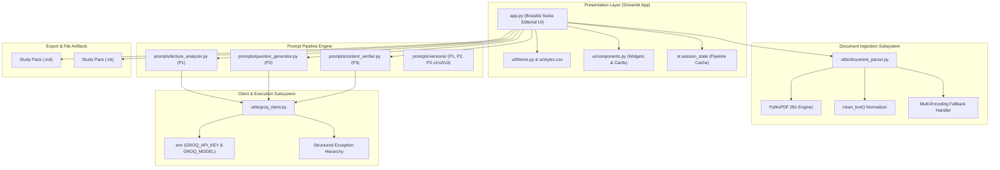

# LastHope — Lecture-to-Revision Assistant
## Supporting Technical Report (Milestone 2 Submission)

**Project Team:** Temperature 0  
**Repository:** [https://github.com/hriday-thakur/LastHope.git](https://github.com/hriday-thakur/LastHope.git)  

---

### Academic Submission Metadata

| Field | Submission Details |
| :--- | :--- |
| **Project Title** | LastHope — AI Lecture-to-Revision Assistant |
| **Team Name** | Temperature 0 |
| **Team ID** | PE-B65-36 |
| **Batch / Section / Group** | Batch 80 / Section 40 / Group 20 |
| **Course Code & Title** | SCSE4041 — Prompt Engineering |
| **Faculty Guide / Mentor** | Dr. Sonal Kukreja |
| **Institution** | Bennett University |
| **Team Member 1** | Hriday Thakur (Enrollment ID: S24CSEU2000) |
| **Team Member 2** | Keshav Kumar (Enrollment ID: S24CSEU1998) |
| **Team Member 3** | Rudransh Jiyala (Enrollment ID: S24CSEU2013) |
| **Milestone** | Milestone 2: Core Prompt Implementation, Architecture & Verification |
| **Submission Date** | 22 November 2026 |

---

## 1. Abstract

Modern higher education increasingly relies on dense, fragmented slide presentations and terse lecture notes. When preparing for examinations, students frequently struggle to extract coherent conceptual narratives, identify examinable formulas, generate practice questions, and verify whether AI-generated study aids are factually grounded. This report presents the technical design, architectural implementation, prompt engineering methodology, and empirical verification of **LastHope**, a modular AI-assisted lecture-to-revision system developed by Team *Temperature 0*. 

LastHope implements a deterministic, multi-stage pipeline comprising: (1) robust multi-page PDF and multi-encoding TXT document parsing with page-number preservation; (2) **Prompt 1 (P1)**, an academic lecture analyzer that generates structured, page-attributed revision notes; (3) **Prompt 2 (P2)**, an exam question generator that synthesizes tiered practice questions across multiple-choice, short-answer, and quantitative formats; (4) **Prompt 3 (P3)**, an adversarial content verification auditor that cross-examines generated materials against the source text to detect factual hallucinations, answer-key label contradictions, and calculation errors; and (5) a consolidated Study Pack export subsystem. Built with Python 3.10+, PyMuPDF, the Groq Cloud SDK (`openai/gpt-oss-120b`), and Streamlit featuring a Swiss Brutalist ("Red Pen") editorial interface, LastHope demonstrates that structured, staged prompt architectures combined with independent verification significantly enhance study material reliability while providing full transparency regarding AI limitations.

---

## 2. Introduction and Problem Statement

### 2.1 The Academic Revision Bottleneck
In contemporary university curricula, lecture slide decks represent the primary medium for course delivery. While slides are effective for synchronous classroom presentations, they are notoriously ill-suited for independent revision:
- **Terse and Fragmented Information:** Slides prioritize bullet points and keywords over comprehensive explanations, leaving critical conceptual links unstated.
- **Scattered Formulas and Notations:** Quantitative definitions often lack stated parameter ranges, units, or derivation steps.
- **Omission of Self-Assessment:** Slide decks rarely include sufficient exam-style practice questions with complete, step-by-step solutions.

### 2.2 Vulnerabilities of Naive LLM Solutions
While general-purpose Large Language Models (LLMs) can summarize text, unconstrained zero-shot prompts introduce substantial educational risks:
1. **Curriculum Extrapolation & Hallucination:** Generalist models frequently inject advanced textbook concepts (e.g., introducing multi-level cache replacement policies or complex associativity formulas) that were never covered in the specific course lecture, misleading students on examinable scope.
2. **Mathematical and Cycle-Count Errors:** LLMs struggle with multi-step arithmetic, frequently introducing calculation errors in quantitative problems (e.g., Average Memory Access Time calculations or memory cycle counts).
3. **Internal Answer-Key Contradictions:** Models often declare one multiple-choice option letter (e.g., `Option B`) in the answer key header, but proceed to argue or calculate that a different option (e.g., `Option A`) is correct in the explanation body.
4. **Silent Failures:** Students relying on unverified AI summaries have no mechanism to distinguish between grounded facts and convincing hallucinations.

### 2.3 The LastHope Approach
LastHope addresses these challenges by replacing monolithic zero-shot prompts with a decoupled, four-stage pipeline. By strictly tracking source page numbers (`--- [Page X] ---`), constraining generation scope, enforcing cognitive variety, and implementing an independent verification auditor (P3), LastHope creates a transparent, reliable revision workflow.

---

## 3. Project Objectives and Scope

### 3.1 Primary Project Objectives
1. **Deterministic Document Parsing:** Extract text from multi-page PDFs and multi-encoding text files while preserving explicit page delimiters and rejecting corrupt, empty, or unreadable files.
2. **Structured Lecture Analysis (P1):** Produce standardized revision notes covering executive overviews, topic breakdowns, definition tables, high-yield takeaways, and explicit syllabus gaps.
3. **Cognitive Tier Assessment Generation (P2):** Generate tiered revision questions (`[Easy]`, `[Medium]`, `[Hard]`) across Multiple-Choice, Short-Answer, and Quantitative problem types, maintaining an unspoilered practice layout.
4. **Adversarial Content Verification (P3):** Audit all generated materials against the original lecture text as the sole ground truth, re-computing arithmetic from first principles and checking answer keys for label consistency.
5. **Session-Persistent User Interface:** Provide an editorial, brutalist frontend in Streamlit that prevents redundant API invocations and exports composite Markdown and Plaintext study packs.

### 3.2 System Scope & Boundaries
- **In Scope:** Digital vector PDFs, plain text documents, multi-encoding fallback (`utf-8`, `utf-8-sig`, `cp1252`, `iso-8859-1`, `latin-1`), structured prompt chaining, independent fact-checking, and file export.
- **Out of Scope (By Design):** Optical Character Recognition (OCR) for scanned image-only PDFs, automated essay grading, live audio transcription, and multi-file batch merging.

---

## 4. Proposed Solution & System Workflow

LastHope structures the revision generation process into five sequential, state-managed stages:

```
┌────────────────────────────────────────────────────────────────────────┐
│ Stage 01: Document Intake & Preprocessing                              │
│ - Upload PDF or TXT lecture slides/notes                               │
│ - Validate format, non-empty content, and encoding                     │
│ - Preserve page markers: "--- [Page X] ---"                            │
└───────────────────────────────────┬────────────────────────────────────┘
                                    │
                                    ▼
┌────────────────────────────────────────────────────────────────────────┐
│ Stage 02: Lecture Content Analysis (P1)                                │
│ - Ingest extracted lecture text                                        │
│ - Generate structured Markdown revision notes with page citations      │
│ - Isolate stated gaps from external knowledge                          │
└───────────────────────────────────┬────────────────────────────────────┘
                                    │
                                    ▼
┌────────────────────────────────────────────────────────────────────────┐
│ Stage 03: Practice Questions & Assessment Generation (P2)              │
│ - Ingest original lecture text + P1 structured notes                   │
│ - Generate tiered MCQs, Short-Answer, and Quantitative problems        │
│ - Format in unspoilered Practice Mode with separate Answer Key         │
└───────────────────────────────────┬────────────────────────────────────┘
                                    │
                                    ▼
┌────────────────────────────────────────────────────────────────────────┐
│ Stage 04: Content Verification & Fact-Check Audit (P3)                 │
│ - Cross-examine P1 notes & P2 questions against Original Source Text   │
│ - Step-by-step arithmetic recomputation & answer-key label check      │
│ - Output structured audit report with status: PASS / WARNINGS / REVISE │
└───────────────────────────────────┬────────────────────────────────────┘
                                    │
                                    ▼
┌────────────────────────────────────────────────────────────────────────┐
│ Stage 05: Consolidated Study Pack Export                               │
│ - Compile complete composite study pack docket                         │
│ - Download verified bundles in Markdown (.md) and Plaintext (.txt)     │
└────────────────────────────────────────────────────────────────────────┘
```

---

## 5. System Architecture

The architecture of LastHope is organized into four decoupled layers: the Ingestion & Parsing Subsystem, the Groq API Client Wrapper, the Prompt Pipeline Engine, and the Streamlit Presentation Layer.

### 5.1 Architectural Component Diagram



---

## 6. Technology Stack & Technical Rationale

| Layer / Dependency | Technology Selected | Version | Technical Justification |
| :--- | :--- | :--- | :--- |
| **Language Runtime** | Python | 3.10+ | Standard cross-platform language for modern AI orchestration and data processing. |
| **Document Parsing** | PyMuPDF (`pymupdf`) | 1.25.3+ | Extremely fast C-backed PDF engine; provides reliable vector text extraction and exact per-page boundaries without heavy Java/OCR dependencies. |
| **LLM Inference API** | Groq Python SDK (`groq`) | 0.18.0+ | Delivers ultra-low latency inference via Groq Language Processing Units (LPUs), enabling responsive multi-stage prompt execution within interactive UI sessions. |
| **Configured Model** | `openai/gpt-oss-120b` | Cloud API | High-parameter open-weights architecture capable of rigorous multi-step reasoning, mathematical derivations, and critical auditing. |
| **Environment Security** | `python-dotenv` | 1.0.1+ | Isolates API credentials in `.env`, strictly excluded from version control via `.gitignore`. |
| **Frontend Framework** | Streamlit | 1.38.0+ | Rapid, reactive web framework allowing custom HTML/CSS injection, state management, and seamless tabbed navigation without full-stack JavaScript complexity. |
| **Design Typography** | Space Grotesk & JetBrains Mono | Google Fonts | High-legibility editorial grotesque paired with monospace technical typography, reinforcing the Swiss brutalist "Red Pen" design theme. |

---

## 7. Prompt Engineering Methodology

The LastHope prompt architecture implements a modular separation of concerns. Prompts are treated as version-controlled software assets stored in `prompts/versions/`.

### 7.1 Overview of the Three Pipelines
1. **Prompt 1 (P1) — Lecture Content Analyzer:**
   - *Persona:* Expert academic lecture analyst and revision assistant.
   - *Core Directives:* Strict factual grounding; verbatim terminology preservation; student-friendly explanations; explicit page attribution (`[Page X]`); and isolation of gaps/ambiguities.
   - *Output Schema:* 5-part Markdown structure (Executive Overview, Topic Breakdown, Definition Table, High-Yield Takeaways, Topics Needing Clarification).
2. **Prompt 2 (P2) — Revision Question Generator:**
   - *Persona:* Academic assessment specialist and exam question designer.
   - *Core Directives:* Grounded question synthesis; cognitive depth calibration (`[Easy]`, `[Medium]`, `[Hard]`); balanced distribution (MCQs, Short-Answer, Quantitative); and unspoilered practice layout with separated answer key.
   - *Output Schema:* Part 1 (Practice Mode) and Part 2 (Complete Answer Key & Explanations).
3. **Prompt 3 (P3) — Content Verification Assistant:**
   - *Persona:* Rigorous academic content reviewer, auditor, and fact-checking assistant.
   - *Core Directives:* Original lecture text treated as the sole ground truth; independent cross-examination of P1 and P2; first-principles calculation auditing; answer-key label consistency checking; and transparent academic disclaimers.
   - *Output Schema:* 7-part Markdown audit report with final status (`PASS`, `PASS WITH WARNINGS`, `NEEDS REVISION`).

### 7.2 Catalog of the Nine Prompt Versions

To document the evolutionary trajectory of the system, nine prompt files are maintained in `prompts/versions/`:

```
prompts/versions/
├── P1_v1.txt   [ACTIVE IMPLEMENTATION - Tested Live on Groq API]
├── P1_v2.txt   [PROPOSED ITERATION - Boundary rules & negative constraints]
├── P1_v3.txt   [PROPOSED ITERATION - Dual gap categorization & formula blocks]
├── P2_v1.txt   [ACTIVE IMPLEMENTATION - Tested Live on Groq API]
├── P2_v2.txt   [PROPOSED ITERATION - Two-pass derivation & label alignment]
├── P2_v3.txt   [PROPOSED ITERATION - 4-step calculation scratchpad & distractor analysis]
├── P3_v1.txt   [ACTIVE IMPLEMENTATION - Tested Live on Groq API]
├── P3_v2.txt   [PROPOSED ITERATION - Dual audit tables & explicit label contradiction check]
└── P3_v3.txt   [PROPOSED ITERATION - Machine-readable JSON schema & objective decision matrix]
```

> **Crucial Academic Disclosure on Version Testing Status:**  
> In strict accordance with scientific integrity standards, **only Version 1.0 prompts (`P1_v1.txt`, `P2_v1.txt`, `P3_v1.txt`) have live execution evidence** generated from the active Groq API baseline. Versions 2.0 and 3.0 represent archival design iterations formulated from observed defects; they remain **untested** against live API calls in this milestone to avoid fabricating performance metrics.

---

## 8. Implementation Details

### 8.1 Module Organization
The project follows a clean, decoupled directory structure:
- `utils/document_parser.py`: Ingestion logic, clean text normalization, PyMuPDF wrapper, and custom parsing exceptions.
- `utils/groq_client.py`: Secure API client initialization, timeout management, retry configuration (`max_retries=1`), and exception mapping.
- `prompts/lecture_analyzer.py`: Execution harness for P1 revision notes generation.
- `prompts/question_generator.py`: Execution harness for P2 assessment generation with question count validation.
- `prompts/content_verifier.py`: Execution harness for P3 independent verification audit.
- `ui/theme.py` & `ui/styles.css`: CSS injection and styling rules implementing the Swiss Brutalist aesthetic.
- `ui/components.py`: Modular UI components (Stage rails, intake receipts, margin cards, verdict boards, study pack dockets).
- `app.py`: Main Streamlit application orchestrating session state, pipeline execution, and user interactions.

### 8.2 Frontend Design: Swiss Brutalist ("Red Pen" Theme)
The frontend eschews standard generic SaaS aesthetics in favor of a specialized academic editorial design:
- **Typography:** Display titles in *Space Grotesk* (bold grotesque) and tabular/code elements in *JetBrains Mono*.
- **Color Palette:** Stark monochromatic canvas (`#FFFFFF` background, `#111111` ink) accented with `#D9381E` ("Red Pen" accent) and amber warning highlights.
- **Micro-Interactions:** Custom intake receipts displaying file size and page metrics; dynamic pipeline progression rails; and a dedicated **Verdict Board Header** rendering verified, warning, and error counters with color-coded status badges.

### 8.3 State Management & Data Consistency
Streamlit re-runs scripts top-to-bottom on every user interaction. To prevent catastrophic UI resetting and redundant Groq API invocations, LastHope manages state through `st.session_state`:
- `parsed_doc`: Holds the active `ParsedDocument` object.
- `p1_analysis`: Holds generated revision notes.
- `p2_questions`: Holds generated practice questions.
- `p3_verification`: Holds the verification audit report.
- **Pipeline Invalidation Logic:** If a user uploads a new document, all downstream outputs (`p1_analysis`, `p2_questions`, `p3_verification`) are atomically set to `None`, guaranteeing that old revision notes cannot be mixed with a newly loaded lecture.

### 8.4 Structured Error Handling
All failure modes are intercepted and converted into user-friendly Streamlit banners without exposing raw tracebacks or API keys:

| Exception Class | Trigger Condition | User Notification in UI |
| :--- | :--- | :--- |
| `MissingAPIKeyError` | `GROQ_API_KEY` missing or default template in `.env`. | `"CONFIGURATION ERROR: Please add your Groq API key to .env"` |
| `AuthenticationError` | Groq API rejects provided credentials. | `"AUTHENTICATION ERROR: Invalid Groq API key in .env"` |
| `ModelNotFoundError` | Configured model ID is unavailable or deprecated. | `"MODEL ERROR: Model was not found or is inaccessible"` |
| `RateLimitExceededError` | Groq API token or request throughput exceeded. | `"RATE LIMIT EXCEEDED: Please wait a moment before retrying"` |
| `APIRequestTimeoutError` | Network request exceeds function or app timeout. | `"REQUEST TIMEOUT: Request timed out while communicating with Groq"` |
| `EmptyDocumentError` | Uploaded file is 0 bytes, whitespace-only, or scanned PDF. | `"DOCUMENT EMPTY: PDF contains no extractable text layer / OCR required"` |
| `UnsupportedFormatError` | User attempts to upload unsupported format (e.g. `.docx`). | `"UNSUPPORTED FORMAT: Supported formats are .pdf, .txt"` |

---

## 9. Testing & Evaluation Summary

LastHope was evaluated using a four-tier testing hierarchy documented in [`test-report.md`](../test-evidence/test-report.md):

```
┌────────────────────────────────────────────────────────────────────────┐
│ Summary of Verified Test Coverage (16 Distinct Test Cases)             │
│                                                                        │
│ • Unit Tests (Parser): 11 cases (Whitespace, Multi-page PDF, Streams,  │
│   UTF-8 TXT, Latin-1, CP1252, and 5 Edge Cases) ──▶ 15/15 PASSED (100%)│
│ • Integration Tests: 2 cases (Groq client model resolution & full 5-  │
│   stage pipeline workflow) ────────────────────────▶ 100% PASSED       │
│ • Live LLM Evaluations: 3 cases (P1, P2, P3 execution on Groq) ───────▶│
│ • Browser UI Verification: 1 comprehensive case (DOM, state, downloads)│
└────────────────────────────────────────────────────────────────────────┘
```

### 9.1 Document Parser Unit Test Suite (15 / 15 Tests Passed)
The parser test suite ([`test_document_parser.py`](../test-evidence/test_document_parser.py)) verified:
1. Whitespace cleaning and normalization across newline variations (`\r\n`, `\n`).
2. Multi-page PDF extraction preserving page markers `--- [Page 1] ---` and `--- [Page 2] ---`.
3. In-memory `io.BytesIO` binary stream parsing without physical disk reliance.
4. UTF-8 plain text extraction with accurate page and word count calculation.
5. Latin-1 encoding fallback preserving French accents and currency symbols (`£`).
6. CP1252 encoding fallback preserving Windows-specific Euro symbols (`€`).
7. **Edge Case:** Scanned / Image-only 2-page PDF raising `EmptyDocumentError`.
8. **Edge Case:** 0-byte PDF upload raising `EmptyDocumentError`.
9. **Edge Case:** Corrupt PDF header raising `DocumentParsingError`.
10. **Edge Case:** Whitespace-only text document raising `EmptyDocumentError`.
11. **Edge Case:** Unsupported format (`.docx`) raising `UnsupportedFormatError`.

### 9.2 End-to-End Workflow Pipeline Test Suite
The workflow integration suite ([`test_app_workflow.py`](../test-evidence/test_app_workflow.py)) executed a sample lecture on Binary Search Trees (BST) and AVL trees across all 5 stages, verifying that data propagates cleanly and that study-pack assembly correctly includes or excludes the P3 audit depending on execution state.

### 9.3 Browser-Level UI and Download Verification
Browser automation verified the live application running on `http://localhost:8501`:
- Ingested `sample_lecture.txt` and verified the dynamic Intake Receipt card.
- Executed P1 and verified that `[Page 1]` and `[Page 2]` tags rendered in the revision notes view.
- Executed P2 and toggled **Exam Mode**, confirming that the inline answer key was hidden into an unspoilered drawer without wiping session state.
- Executed P3 and confirmed that the **Verdict Board Header** rendered status badges accurately.
- Executed Stage 05 download controls, successfully generating and verifying the 20,154-byte composite study pack files ([`LastHope_sample_lecture_StudyPack_20261122_1930.md`](../test-evidence/LastHope_sample_lecture_StudyPack_20261122_1930.md) and [`.txt`](../test-evidence/LastHope_sample_lecture_StudyPack_20261122_1930.txt)).

---

## 10. Results and Empirical Discussion

### 10.1 Live LLM Sample Run Analysis
A sample 2-page lecture deck titled *"CS301: Computer Architecture — Lecture 7: Cache Memory & Memory Hierarchy Basics"* was processed through the live Groq pipeline (`openai/gpt-oss-120b`). The outputs were captured in `test_p1_output.md`, `test_p2_output.md`, and `test_p3_output.md`.

#### Empirical Findings from Prompt 1 (P1):
- *Strengths:* Generated structured notes with clean page attributions (`[Page 1]`, `[Page 2]`), accurately defining SRAM vs. DRAM trade-offs, locality principles, the AMAT formula, and the 3 C's of cache misses.
- *Defect:* In Section 5 ("Topics Needing Clarification"), P1 introduced external curriculum terms ("Replacement Policies LRU/FIFO", "Associativity impact on hit time") that were absent from the lecture text.

#### Empirical Findings from Prompt 2 (P2):
- *Strengths:* Successfully generated 8 practice questions across recall, conceptual, and quantitative tiers, formatting them into an unspoilered practice section and separate answer key.
- *Defect 1 (Answer Key Contradiction):* In Question 4:
  $$\text{AMAT} = 2 + (0.04 \times 120) = 2 + 4.8 = 6.8\text{ cycles}\quad (\text{Option A})$$
  The answer key declared `Correct Answer: B`, then calculated 6.8 and added: `"Wait, that matches option A. Oops, re-evaluate: Option A is correct."`
- *Defect 2 (Arithmetic Recalculation Error):* In Question 7(b), the miss rate halved from 2% to 1%. P2 updated miss cycles ($0.8 \times 10^9$), but kept hit cycles fixed at $2.94 \times 10^9$ instead of recalculating for the new hit count ($9.9 \times 10^8 \times 3 = 2.97 \times 10^9$), reporting an incorrect total of $3.74 \times 10^9$ cycles instead of $3.77 \times 10^9$ cycles.
- *Defect 3 (Scope Creep):* Questions 3 and 8 tested cache associativity and sequential array traversal miss patterns not present in the slides.

#### Empirical Verification by Prompt 3 (P3):
When audited by Prompt 3, the verification assistant demonstrated remarkable cross-examination fidelity:
1. **Mathematical Correction:** Independently recomputed Question 7(b) and explicitly flagged the 30-million-cycle calculation omission, providing the corrected derivation ($3.77 \times 10^9$ cycles).
2. **Label Discrepancy Detection:** Flagged Question 4 as an internal label contradiction between the declared letter (B) and the calculated choice (A).
3. **Grounding Audit:** Verified 10 core concepts as fully grounded, while correctly identifying Questions 3 and 8 as unsupported inferences.
4. **Transparent Status:** Rated the revision set as **PASS WITH WARNINGS**, ensuring students were alerted to flaws before studying.

### 10.2 Why Verification is Useful but Not a Absolute Guarantee
The empirical findings underscore the necessity of adversarial auditing in educational AI systems. However, LastHope explicitly rejects the notion that AI verification offers a 100% guarantee of factual truth:
- **Auditor Model Bounds:** P3 is itself an LLM operating at low temperature (0.1). While it exhibits high analytical rigor, it remains subject to probabilistic limitations.
- **Dependency on Ingestion:** If a source document contains OCR degradation or missing symbols, P3's primary source of truth is impaired.
- **Pedagogical Paraphrasing vs. Hallucination:** Distinguishing between student-friendly rephrasing and true factual extrapolation remains a nuanced boundary.
- **Academic Disclaimer:** Consequently, LastHope displays a mandatory disclaimer on every audit report, instructing students and educators to consult primary course texts for high-stakes exam preparation.

---

## 11. System Limitations

1. **Absence of Integrated OCR:** Scanned PDF documents containing bitmap images of text are rejected with an `EmptyDocumentError` rather than transcribed. Users must run external OCR software prior to upload.
2. **Single-Document Ingestion:** The current implementation restricts ingestion to one file per session (`accept_multiple_files=False`). Multi-week lecture decks cannot be aggregated in a single upload.
3. **Context Window Boundaries:** While `openai/gpt-oss-120b` possesses a large context window, slide decks exceeding 100 pages may experience token truncation or degradation in granular page citation accuracy.
4. **External API Dependency:** System availability is tethered to Groq Cloud infrastructure and local internet connectivity. Offline operation is not supported.

---

## 12. Future Enhancements

1. **Embedded Open-Source OCR Engine:** Integrate a lightweight OCR package (e.g., Tesseract or Surya) to automatically process scanned PDF handouts and slide photos without user pre-processing.
2. **Multi-Document Syllabus Aggregator:** Support multi-file uploads allowing students to synthesize comprehensive semester-long revision packages across entire lecture modules.
3. **Anki Flashcard Export (.apkg):** Extend the Stage 05 export docket to generate structured flashcard decks directly importable into spaced-repetition software such as Anki.
4. **Agentic Self-Correction Loop:** Implement an autonomous feedback loop where P3's structured error report is fed back into P2, automatically re-generating flawed questions or correcting answer keys before human presentation.

---

## 13. Conclusion

The LastHope project demonstrates that converting unstructured lecture slides into high-yield, exam-oriented study packs requires far more than generic LLM summarization. By engineering a decoupled pipeline that couples robust PyMuPDF ingestion, structured lecture analysis (P1), tiered assessment design (P2), and independent adversarial fact-checking (P3), LastHope provides an academically disciplined revision assistant. 

Empirical testing confirmed that the system reliably extracts lecture content across diverse file formats (15/15 parser tests passed) and that the verification stage successfully catches real-world LLM calculation errors and answer-key label contradictions. While no AI system can guarantee absolute factual perfection, LastHope's transparent verification audit, page-attribution rigor, and Swiss Brutalist interface empower students to revise efficiently while remaining fully aware of AI limitations.

---

## 14. References

1. **Streamlit Documentation:** *Streamlit API Reference & Session State Architecture.* Available at: `https://docs.streamlit.io/`
2. **PyMuPDF Documentation:** *PyMuPDF (fitz) Vector PDF Text Extraction and Document Geometry.* Available at: `https://pymupdf.readthedocs.io/`
3. **Groq Cloud API Documentation:** *Groq Python SDK & Language Processing Unit (LPU) Inference Reference.* Available at: `https://console.groq.com/docs/`
4. **Python Standard Library:** *Python 3.10+ Language Specification & io.BytesIO Memory Buffers.* Available at: `https://docs.python.org/3/`
5. **python-dotenv:** *Environment Variable Management for 12-Factor Applications.* Available at: `https://pypi.org/project/python-dotenv/`
6. **GitHub Flavored Markdown (GFM):** *GFM Syntax Specification for Tables, Callouts, and LaTeX Formatting.* Available at: `https://github.github.com/gfm/`
